# EndHud

**《明日方舟：终末地》游戏辅助面板。** 提供连携技就绪提示（含倒计时）、按战斗状态切换的排轴、按自己写的条件弹出的战斗提示，以及全队终结技、干员专属计数和连击等增益的状态监视。键鼠和[手柄](#手柄)均支持，战斗中可随时切换。

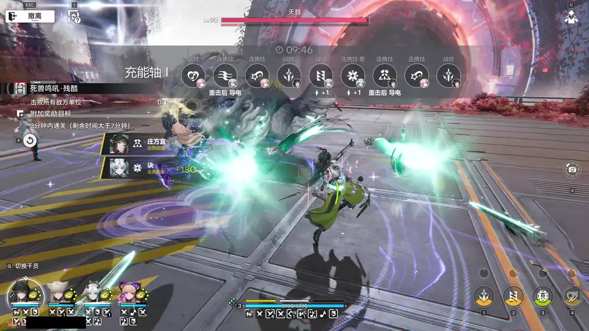

EndHud 独立运行，仅通过读取屏幕画面获取信息，方式与录屏软件相同。它不打开、读取或修改游戏进程，不注入代码，也不代替玩家操作游戏。

> ⚠️ **免责声明**
>
> 在网络游戏中使用第三方工具存在风险。游戏使用 ACE 反作弊系统，运营方的用户协议也可能限制第三方软件。EndHud 完全在游戏进程之外运行，但无法保证不被反作弊系统判定为违规程序。
>
> 请在了解上述风险后自行决定是否使用，并对自己的游戏账号负责。因使用本工具产生的一切后果（包括但不限于账号警告、封禁）由使用者自行承担，开发者不承担任何责任。

## 下载

**[下载最新版本（Releases 页面）](https://github.com/Nedlitex/EndHud/releases/latest)**

- `EndHud-版本号.msi`：安装包（推荐），为当前用户安装，无需管理员权限。
- `EndHud-版本号-portable.exe`：免安装版，双击即可运行。

两者均已包含全部运行组件和干员头像库，首次运行可离线使用。联网时，EndHud 启动后会检查更新，并在游戏未运行时自动安装新版本，同时更新推荐排轴和干员头像库。安装步骤见[安装](#安装)。

## 新功能

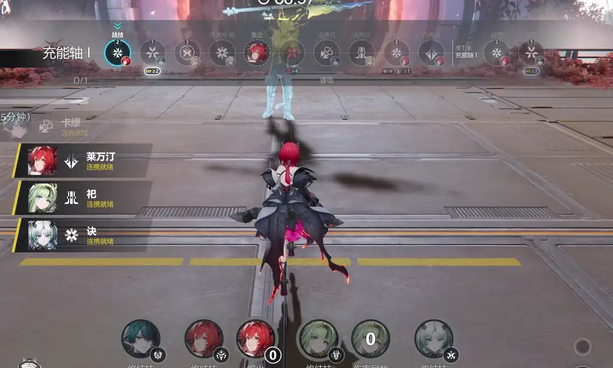

- **排轴按画面点亮步骤**：放了哪个技能就点亮哪一步，顺序不限，不会跳过任何一步；箭头指向下一个还没打的步骤（青色：现在可以放；白色：还不行）。每个轴段可以设“完成条件”，决定这一轮什么时候算打完。见[排轴](#排轴)。
- **步骤上的小图标和按键**：设了条件的步骤下方显示条件的小图标，成立时亮起；战技步骤上方标出要按的键（1–4，手柄为对应的面键）。
- **条件步骤**：一步不放技能，只等条件满足，例如“敌人有 寒冷附着 至少 3 层”。
- **更多条件，排轴和战斗提示通用**：敌人失衡、队伍增益层数（连击层数）、战技已强化、终结技剩余持续时间、当前轴段、轴段已完成次数；技力条变长（例如 7 格）时也能读取，技力条件最高到 20。见[可用条件](#排轴)和[敌人失衡](#敌人失衡)。
- **轴段优先级**：几个轴段同时满足条件时，显示优先级最高的。
- **重击、下落攻击和“当前操控”**：可以作为排轴步骤显示。
- **新推荐排轴**：卡缪 莱万汀 祀 诀、祀 别礼 诀 汤汤。
- **战斗提示可以只对指定小队生效**，失衡等新条件也能用来弹出提示。见[战斗提示](#战斗提示)。
- **副本和大世界分开设置**：副本战斗（左上角有“撤离”）中照常显示；大世界战斗中默认不显示排轴，可在菜单中打开。左上角显示“探索 / 工业”切换按钮（不在战斗）时全部隐藏。见[显示时机](#排轴)。
- **手柄放战技也能点亮步骤**：手柄布局下同样读取战技按钮的闪光和“战技已强化”的光环。见[手柄](#手柄)。
- **MSI Afterburner（RivaTuner）**：屏幕显示挡住游戏界面时怎么办，见[常见问题](#常见问题)。

---

## 功能

### 连携就绪提示

战斗中，干员的连携技冷却结束时，屏幕上滑入提示。以下为实战录像（“一直显示”模式）。

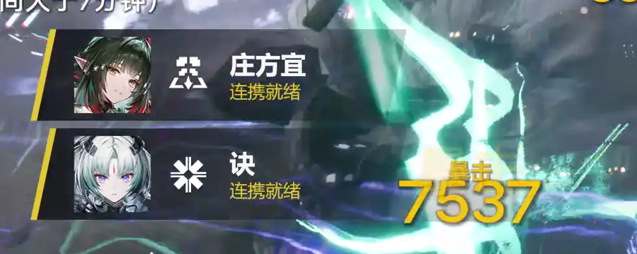

<details><summary>详细说明</summary>

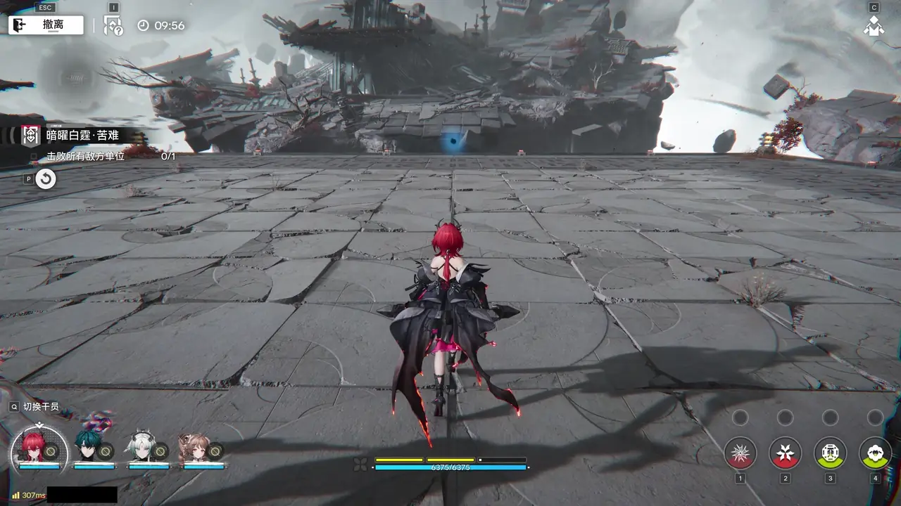

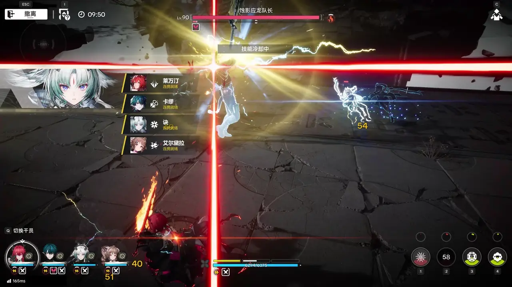

- **显示方式**（在菜单中选择）：
  - **冷却结束时提示**：显示 2、3 或 5 秒（默认 3 秒）后滑出。
  - **一直显示直到再次使用**：连携技就绪期间持续显示。
- **提前提示**：就绪前显示倒计时（例如“0.5 秒后就绪”），可设为关闭、0.5、1、2 或 3 秒，默认 1 秒。倒计时中为灰蓝色，就绪时边框变为金色并闪动一次。
- **位置**：打开菜单（Ctrl+Shift+M）后可拖动提示框；“恢复默认位置”可复原。位置按游戏窗口比例保存。
- 冷却被技能提前刷新时同样提示；终结技动画期间结束的冷却，在画面恢复后提示。
- 非战斗状态（包括左上角显示“探索 / 工业”模式切换按钮时，见[排轴的显示时机](#排轴)）、已阵亡的干员，以及战斗开始时已就绪的连携技不提示。

</details>

### 自动识别干员

EndHud 根据小队栏头像自动识别小队中的干员（一至四人），并在提示中显示对应的名字和头像。干员头像库随程序提供；游戏推出新干员后，头像库通过“检查更新”自动更新。

<details><summary>详细说明</summary>

小队栏出现后约一秒内完成识别，识别完成前不显示连携提示。战斗中头像被特效遮挡或变淡时，识别结果保持不变；更换小队后自动重新识别。如有识别错误，可在菜单的“干员识别”中为该位置指定正确的干员，EndHud 会记住该选择。

</details>

### 排轴

可为每个小队编写排轴（战技、连携技、终结技的使用顺序）。战斗中，屏幕上方显示排轴，并**根据当前战斗状态显示对应的轴段**，样式与常见排轴图一致。

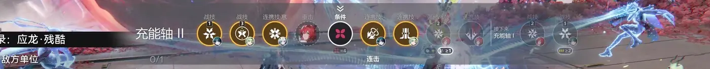

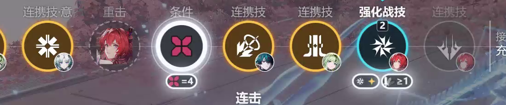

打开编辑器：菜单“排轴”一栏的“编辑排轴…”，或右键托盘图标选择“编辑排轴”。排轴保存在 `%APPDATA%\EndHud\rotations`。

<details><summary>详细说明</summary>

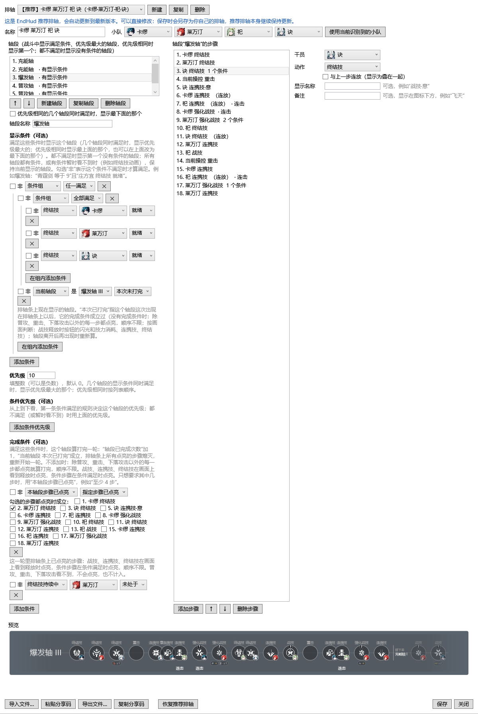

- **按小队自动加载**：识别出小队后，自动加载为这四位干员编写的排轴，与站位顺序无关。
- **轴段与条件**：排轴由若干轴段组成（例如“充能轴 I”“充能轴 II”“爆发轴”），每个轴段设有显示条件，例如充能轴 I：“猎矢 = 4，诀和梨诺的终结技均未就绪”；爆发轴：“猎矢 = 0、启示 = 8，诀和梨诺的终结技充能均 ≥ 80%”。EndHud 显示满足条件的轴段中优先级最大的一个（优先级相同时显示第一个，也可设为显示最后一个），见下文“优先级”；均不满足时显示没有条件的轴段，没有这样的轴段或条件暂时看不到时（例如终结技动画）保持当前轴段。**轴段一旦显示，会先打完再换**：打完之前，即使它的显示条件不再成立（例如放完终结技后“终结技就绪”不成立了），也不会退回，只有优先级更大的轴段条件成立时才会插进来；只有普攻/重击/下落攻击、又没设完成条件的轴段（打不完）仍按条件随时切换。条件可通过“全部满足 / 任一满足”的条件组组合，每个条件都可勾选“非”表示相反。
- **步骤显示**：步骤按顺序列出，并附带备注（例如“重击后”“再普攻×5”）。EndHud 按画面**点亮**你打过的步骤，顺序不限：看到哪个技能就点亮哪一步（橙色圆环），还没打的步骤变暗，普攻、重击和下落攻击看不到，以虚线圆环留在原位；第一个还没点亮的步骤标出箭头（青色：现在可以放；白色：还不行）。不会跳过任何一步，见下文“跟踪打到哪一步”和“完成条件”。
- **战技按键**：每个战技步骤（包括“强化战技”）的圆圈正上方、步骤名称下方有一个小方块，写着放这个战技要按的键，即该干员当前所在队伍位置的数字键 1–4。按游戏中队伍当前的顺序判断：同样的四位干员换了位置，按键也跟着变。手柄布局下改为显示对应方向的面键（左 □ 为 1 号位、上 △ 为 2 号位、右 ○ 为 3 号位、下 × 为 4 号位，按住 L1/LB 再按；Xbox 手柄上分别是 X、Y、B、A，EndHud 分不出手柄型号，统一画 PlayStation 符号）。该干员还没被识别出来时不显示。编辑器的预览只在当前识别出的队伍正是这套排轴的队伍时显示。
- **条件小图标**：步骤设了条件时，圆圈正下方（备注上方）每个条件显示一个小图标，不写文字：条件的图标加比较符号和数字，例如连击图标“≥1”、灼热附着图标“≥1”、熔火图标“=4”、技力“≥2”、终结技充能“≥90%”。条件现在成立时图标亮起白色光圈（和条件步骤满足时一样，刚成立时会闪几下），不成立或暂时无法判断时变暗；箭头后面的步骤也按当前画面判断。“没有 / 未就绪 / 未持续 / 非”在图标上画一道红色斜线；持续中加一个小三角，战技已强化加一颗小星；“或”的几个条件之间用“/”隔开。箭头所在的战技技力不足 1 时，下方显示一个变暗的技力图标“≥1”；冷却中、连携技或终结技未就绪时不另加图标，白色箭头就表示还不行。所有步骤都点亮、但完成条件还没成立时，完成条件的小图标显示在最后一步后面。条件的文字写法只用在战斗提示和编辑器中。
- **样式**：半透明灰色横条，两端渐隐，默认位于屏幕上方正中。
- **可用条件**（均从列表中选择，不用手动输入；排轴的显示条件、完成条件、条件步骤、优先级规则和战斗提示用的是同一份列表）：
  - 技力：至少 / 至多 / 等于 / 小于 / 大于某个值，从 0.0 到 20.0，每 0.1 一档（例如“技力 至少 1.8”）。技力条有几格由 EndHud 从画面读取，常见的 3 格以外，变长的技力条（例如 7 格）也能读，最多 20 格；游戏窗口为 1280×720 时最多 17 格，更多时技力算作读不出，不会猜；
  - 某位干员的连携技或终结技：就绪 / 已使用；
  - 连携技冷却、终结技充能：至少 / 至多 / 等于 / 小于 / 大于某个百分比，从 0% 到 100%，每 1% 一档（终结技充能“至多 0%”即刚放完）。百分比按画面估算，误差约 ±4%；
  - 战技：就绪 / 冷却中；
  - 干员资源：莱万汀的“熔火”（0–4）、提弗洛斯的“猎矢”（0–4）和“启示”（0–8）、庄方宜的“青霆剑”（0–9）、祀的“伤害层数”（没有上限，列表中可选 0–200）；
  - 敌人状态：有 / 没有某种附着或异常（例如灼热附着、导电）；元素附着还可以选“至少 1–4 层”，腐蚀和导电还可以选“至少 I–IV 级”，见[敌人附着层数和反应等级](#敌人附着层数和反应等级)；
  - 敌人失衡：失衡进度、失衡节点已达到、处于失衡、失衡剩余时间，见[敌人失衡](#敌人失衡)；
  - 当前操控的干员；
  - 终结技持续中：莱万汀、庄方宜、伊冯等终结技持续期间（读取技力条上方的持续时间条，按颜色判断是谁的；该干员不是当前操控的干员时也成立，例如庄方宜在后台释放终结技、操控的是别人）；
  - 战技持续中：祀的战技持续期间（她的战技按钮变成漩涡或叉形蝴蝶，到变回蝴蝶为止，即她计数圈外的紫色倒计时）。目前只读取祀的；手柄布局下读不到；
  - 战技已强化：某位干员的战技已强化 / 未强化，按该干员战技按钮外圈持续亮着的白色光环判断（光环亮着约半秒以上才算，放战技时一闪而过的光圈不算）。键鼠和手柄布局都能读取，手柄按不按住 LB（L1）都行；按钮被特效或遮挡物盖住、背后画面很亮，或没有截取到游戏窗口时，无法判断；
  - 队伍增益层数：血条左侧连击图标的层数，至少 / 至多 / 等于 / 小于 / 大于某个值（0–4），例如“连击层数 ≥ 1”。图标右下角的数字是层数，没有数字算 1 层，战斗中图标不在算 0 层；不在战斗中或数字被特效挡住时无法判断；
  - 终结技剩余持续时间：至少 / 至多 / 等于 / 小于 / 大于某个百分比（剩余时间占整条持续时间条的比例），没有在持续时算 0%。目前只读取莱万汀、庄方宜、伊冯的；
  - 当前轴段：排轴条上现在显示的是哪个轴段，可以再选“本次已打完”（这个轴段这次出现以后，它的完成条件成立过，见下文“完成条件”）或“本次未打完”。例如“普攻：祀 战技持续中，且（当前轴段 是 充能轴 I 且本次已打完，或 当前轴段 是 普攻）”：打完充能轴 I 后切到普攻，并一直保持到祀的战技结束；
  - 轴段已显示次数：本场战斗中某个轴段出现在排轴条上的次数，见下文；
  - 轴段已完成次数：本场战斗中某个轴段打完的次数，见下文；
  - 本轴段步骤已点亮：全部 / 至少 N 步 / 指定步骤已点亮。只能用在轴段的完成条件里，见下文“完成条件”。
  - 本轴段已进行时间：这个轴段这一轮已经进行了多少秒，至少 / 小于某个秒数（0.5–120 秒，每 0.5 秒一档，从列表中选）。从轴段出现在排轴条上（或上一轮打完）开始计时；看不到小队面板的时候（过场、菜单、终结技演出）不计时，离开战斗后归零。只能用在完成条件、条件步骤和步骤的预期状态里，不能用在显示条件、条件优先级和战斗提示里。例如爆发轴之后的收尾轴里，看不到释放、过几秒才生效的效果，可以各写成一个条件步骤“本轴段已进行时间 至少 X 秒”，到时间就点亮，最后一个点亮时这个轴段就算打完。秒数请按你在游戏里实测的填写。排轴条上显示为时钟图标和秒数。用到它的排轴，旧版 EndHud 无法读取。
- **普攻、重击和下落攻击步骤**：步骤的“动作”可以选“普攻”“重击”或“下落攻击”，排轴条上显示为该干员的头像，标出动作名。干员还可以选“当前操控”，排轴条上显示当时正在操控的干员（看不到时只显示动作名）；可以先选“当前操控”，动作是技能时会自动改为普攻。普攻、重击和下落攻击只用来显示，EndHud 不会识别它们，因此用轴段的进入条件决定什么时候显示，例如轴段“普攻轴”的条件设为“技力 小于 2.0”，里面放一个普攻步骤：技力不足 2 时就提示继续普攻。
- **条件步骤**：步骤的“动作”可以选“条件”，这一步不放技能，只等条件，例如“敌人有 寒冷附着 至少 3 层”。排轴条上显示第一个条件的图标（敌人状态的图标、专属计数的图标、干员头像或技力），下方是每个条件的小图标（不写文字；“备注”照常显示在小图标下方）；条件满足时这一步点亮，这一轮里一直亮着（之后条件不再满足也一样），不论它排在第几步；条件不满足或暂时无法判断时（例如被特效挡住）不会点亮，也不会被跳过。条件步骤不选干员，也不能“与上一步连放”。用到条件步骤的排轴，旧版 EndHud 无法读取。
- **轴段已显示次数**：例如“爆发轴：充能轴 II 已显示 至少 1 次”，表示打过一次充能轴 II 之后才进入爆发轴。轴段每出现在排轴条上一次就算一次（离开再出现算第二次），离开战斗后全部清零。一个轴段的进入条件不能用它自己的显示次数（它一出现次数就变了），编辑器会提示改用其他轴段；引用的轴段被删除时，编辑器也会提示重新选择。
- **跟踪打到哪一步**：始终开启，按画面判断，不需要任何设置。
  - 战技：释放战技时，该号位的战技按钮会闪一下（按钮上半部分变成浅灰色，约 0.1–0.3 秒），同时技力减少 1。EndHud 每秒检查战技按钮 30 次（只截取右下角按钮这一小块），技力减少 1 说明放了战技，按钮的闪光说明是谁放的；没看到闪光时，按钮进入冷却的号位也可以说明是谁；都没有时，如果箭头所在的步骤是一个现在能放的战技，就点亮它。
  - 战技强化：有些战技被强化时，按钮边缘出现一圈持续的白色光环。光环出现不算放了战技；带光环时放出的战技（光环随之消失）照常算一次。
  - 连携技、终结技：连携技条用完、终结技从充满到用掉，各算一次。
  - 看到的技能点亮轴段中**第一个还没点亮的、同一干员同一技能**的步骤，在第几步都可以：例如爆发轴的四个终结技按任意顺序放，放一个亮一个，先放了排在最后的那个也不会让轴段提前结束。没看到的步骤保持变暗，不会被跳过；之后再看到它时照样点亮。
  - 手柄布局下同样检查闪光：放战技要按住 LB（L1），所以闪光出现在按住 LB 时的那组按钮上（按下的按钮先变成浅灰色，放出时变白）。EndHud 每次截取都会判断画面上是哪一组按钮。
- **轴段已完成次数**：例如“爆发轴：充能轴 II 已完成 至少 2 次”。轴段的完成条件每成立一次算完成一次（没有完成条件时：每一步都点亮算一次），中途离开不算，离开战斗后清零。
- **完成条件**：每个轴段可以在编辑器中“显示条件”和优先级下方的“完成条件（可选）”里设置，和显示条件一样从列表中选，可用的条件也一样，另外多一个“本轴段步骤已点亮”：全部 / 至少 N 步 / 指定步骤已点亮（勾选轴段里的步骤）。完成条件成立时，这个轴段算打完一轮：“轴段已完成次数”加 1，“当前轴段 本次已打完”成立，排轴条上点亮的步骤全部熄灭，重新开始一轮。**不设时**，除普攻、重击、下落攻击以外的每一步（包括条件步骤）都点亮就算打完，顺序不限。例如某个技能经常看不清时，可以设为“本轴段步骤已点亮 至少 6 步”。用到完成条件的排轴，旧版 EndHud 无法读取。
- **优先级**：每个有显示条件的轴段可以设一个优先级（整数，默认 0）。几个轴段的条件同时满足时，显示优先级最大的；优先级相同时按列表顺序。还可以添加“条件优先级”：例如“庄方宜终结技就绪时，优先级为 10”，从上到下第一条满足的规则决定优先级，都不满足时用基础优先级。没有显示条件的轴段（都不满足时显示的那个）不参与比较。
- **复制轴段**：在编辑器左侧选中一个轴段，点击“复制轴段”，会在它后面插入“轴段名（副本）”，步骤、进入条件和完成条件都一样，可以接着修改；修改副本不影响原来的轴段。
- **跟踪范围**：只识别战技、连携技和终结技的使用，不识别普通攻击、重击和下落攻击（这三种步骤只用来显示）。战技的使用按技力减少和战技按钮的闪光识别；背景很亮时（例如强烈的特效）偶尔看不出闪光，这时按冷却或箭头所在的步骤判断。
- **推荐排轴**：EndHud 自带推荐排轴（编辑器中标有【推荐】），随“检查更新”每日更新。修改推荐排轴后保存为自己的排轴，原推荐排轴继续更新；已删除的推荐排轴可通过“恢复推荐排轴”找回。
- **分享**：可在编辑器中导出为文件或复制分享码（以 `EHR1:` 开头），他人导入文件或粘贴分享码即可使用。导入同一排轴时可选择替换或另存为副本。用到普攻、重击或下落攻击步骤、“当前操控”、条件步骤、“小于 / 大于”、“轴段已显示次数”、“轴段已完成次数”、优先级、“战技持续中”、“战技已强化”、“队伍增益层数”、“终结技剩余持续时间”、“当前轴段”或完成条件的排轴，旧版 EndHud 无法读取，会提示先更新。
- **显示时机**：仅在战斗中、且当前小队有对应排轴时显示；特效遮挡或终结技动画期间保持显示，战斗结束数秒后隐藏。画面左上角出现“探索 / 工业”模式切换按钮（开放世界中不在战斗时）时立即隐藏；开放世界中遇敌战斗时，该按钮左侧图标变红，此时照常显示。左上角被其他软件的叠加显示（如 RivaTuner / 小飞机的帧数与温度）挡住时，EndHud 不会因此隐藏战斗中的显示，只按小队栏判断。连携提示、战斗提示和状态监视的显示时机与此相同。
- **大世界战斗中默认不显示排轴**：EndHud 看画面左上角区分两种战斗：有“撤离”按钮的是副本战斗（地区副本、Boss 战等），照常显示排轴；开放世界中的战斗（左上角是“探索 / 工业”模式切换按钮，或是开放世界活动自己的按钮和小地图）默认不显示排轴。想在大世界战斗中也显示，在菜单“排轴”一栏勾选“在大世界战斗中也显示排轴”。连携提示、战斗提示和状态监视在大世界战斗中默认照常显示，各自一栏中也有同样的勾选项，取消勾选即可在大世界战斗中隐藏。隐藏时 EndHud 仍在后台跟踪打到哪一步，战斗中途勾选会立即显示当前的步骤。第一次在大世界战斗中隐藏排轴时，托盘会弹出一次通知说明这一点，之后不再提示。左上角被叠加显示挡住、或者看不清时，按最后一次看到的判断；EndHud 启动后还没看到过任何一种按钮时，全部照常显示。
- **位置、大小与不透明度**：打开菜单（Ctrl+Shift+M）时，即使不在战斗中也会显示排轴示例（有当前小队的排轴时显示其第一个轴段），可直接拖动调整位置；菜单中可调整大小（50%–200%）和不透明度（20%–100%）；“恢复默认位置”可复原。

</details>

### 战斗提示

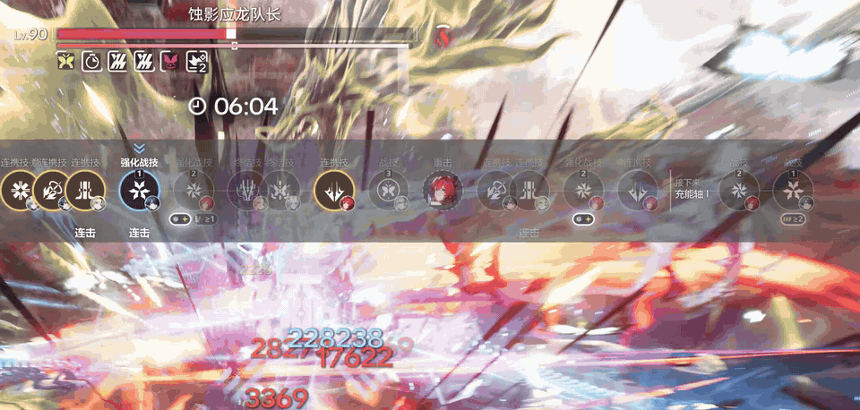

自己写条件，战斗中条件满足时弹出一条提示，例如“技力 至少 1.8 时提示‘可以放战技了’”，或“敌人有 寒冷附着 至少 3 层 时提示‘冻结准备好了’”。每条提示可以对所有小队生效（默认），也可以只在指定小队时生效。

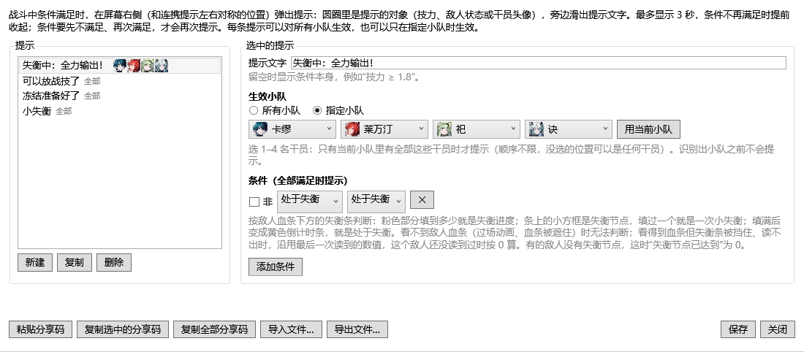

<details><summary>详细说明</summary>

- **位置**：屏幕右侧，和连携提示左右对称：圆圈在右，提示文字从圆圈里向屏幕中间（向左）滑出，边框为橙色。打开菜单拖动连携提示时，战斗提示跟着一起移动；菜单打开时会显示一条示例“战斗提示会在这里弹出”。
- **大小**：菜单“战斗提示”一栏的“大小”滑块可在 50%–200% 之间调整，默认 150%（比以前大一半，更醒目），拖动时示例提示跟着变化；“恢复默认大小”回到 150%。调大后文字会提前换行，不会盖住屏幕中间或连携提示。
- **圆圈里的图标**：按第一个条件自动选择。技力显示技力图标，敌人状态显示该状态的图标，专属计数（莱万汀的熔火、提弗洛斯的猎矢和启示、庄方宜的青霆剑、祀的伤害层数）显示 EndHud 仿照游戏画出的计数图标，失衡条件显示 EndHud 仿照失衡条画出的图标（失衡进度为粉色的失衡条，失衡节点为节点小方框，处于失衡和失衡剩余时间为黄色倒计时条），干员的技能、充能或“当前操控”显示该干员的头像，其他情况显示“!”。
- **显示多久**：最多 3 秒；条件提前不再满足时提前收起。同时最多显示 3 条，再多时最早的一条先收起。没有提示音。
- **什么时候再次弹出**：条件要先**不满足**、再满足，才会再次弹出；一直满足时只弹一次。画面暂时看不清（例如终结技动画、层数被特效挡住）时，既不会弹出，也不会算作“不满足”。离开战斗时全部收起，下一场战斗重新开始。
- **可用条件**：和排轴完全相同，用词也相同（技力、连携技、终结技、战技、干员资源、敌人状态及层数和等级、当前操控、终结技持续中、终结技剩余持续时间、战技持续中、战技已强化、队伍增益层数、失衡进度、失衡节点已达到、处于失衡、失衡剩余时间、当前轴段、轴段已显示次数、轴段已完成次数，以及“全部满足 / 任一满足”条件组和“非”）。战斗提示不属于某个排轴，所以“当前轴段”“轴段已显示次数”“轴段已完成次数”可以选任意排轴的轴段，在排轴条正在显示那个排轴时才会判断。用到“当前轴段”、“轴段已显示次数”、“终结技剩余持续时间”、“战技已强化”、“队伍增益层数”或失衡条件的提示，旧版 EndHud 无法读取。
- **生效小队**：每条提示可选“所有小队”（默认，以前写的提示都是这样）或“指定小队”。指定小队时选 1–4 名干员，只有当前小队里有全部这些干员时才弹出，顺序不限；只选了 3 名时，第 4 个位置是谁都可以。小队还没识别出来时不会弹出；换成别的小队时，已弹出的提示会收起。指定小队的提示，条件里的干员列表只列出这几名干员。有指定小队的提示，旧版 EndHud 无法读取。

**编辑**：菜单“战斗提示”一栏的“编辑战斗提示…”，或右键托盘图标选择“编辑战斗提示”。

- **新建**：点击“新建”，得到一条“技力 至少 2.0”的提示，改成需要的条件，在“提示文字”中写要显示的话（留空时显示条件本身，例如“技力 ≥ 1.8”），然后点击“保存”。保存后战斗中立即生效。
- **指定小队**：在“生效小队”中选“指定小队”，用下面的四个选择框选干员（不需要的格子选“（不选）”），或者点击“用当前小队”直接填入游戏中识别到的小队（小队栏显示、全部干员都识别出来后可用）。一名干员都没选或同一名干员选了两次时无法保存，编辑器会说明原因。左侧列表中，每条提示右边显示“全部”或指定小队的干员头像。
- **修改**：在左侧列表中选中提示，修改条件或文字，再点击“保存”。
- **复制**：选中一条提示，点击“复制”，副本放在它后面。
- **删除**：选中后点击“删除”并确认，删除后无法撤销。EndHud 不会自动删除任何提示。
- **分享**：“复制选中的分享码”或“复制全部分享码”得到以 `EHA1:` 开头的分享码，发给别人；对方点击“粘贴分享码”即可添加。也可以用“导出文件…”和“导入文件…”。导入只会**添加**，不会替换已有的提示；和已有提示完全相同的会跳过，并说明跳过了几条。
- **最多 100 条**：满 100 条后无法新建（提示“最多 100 条提示，请先删除不用的。”），导入时超出的部分不会导入，并说明有几条没有导入。
- **文件损坏时**：提示保存在 `%APPDATA%\EndHud\alerts.json`，更新 EndHud 不会影响它。如果这个文件损坏无法读取，EndHud 不会删除它，而是改名为 `alerts.unreadable-日期时间.json` 留在同一个文件夹里，编辑器中会说明，然后从空白开始。如果文件来自更新版本的 EndHud，编辑器会提示先更新，这时的修改不会保存，以免覆盖它。
- 菜单“战斗提示”一栏右上角的“开启”可以关闭弹出（默认开启）；关闭时仍可编辑提示。战斗提示需要开启“识别小队栏”。

</details>

### 状态监视

战斗中，屏幕下方中间以一排圆形图标显示全队状态，图标中间为干员头像。

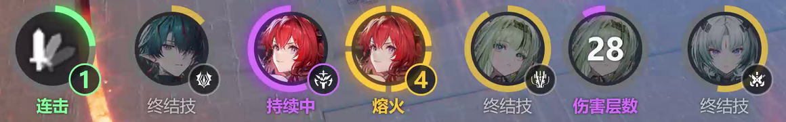

<details><summary>详细说明</summary>

- **终结技**：外圈按充能进度填充（金色），就绪时整圈发光；右下角为终结技图标。莱万汀、庄方宜、伊冯这类持续一段时间的终结技释放后，图标改为紫色发光的圆环，显示剩余持续时间（从满圈逆时针减少），下方标“持续中”。显示在释放者自己的图标上，与当前操控的是谁无关：在后台释放、或释放后切换到其他干员，也照常显示。EndHud 按技力条上方持续时间条的颜色判断是谁的终结技（莱万汀为红色，庄方宜为金色，伊冯为青绿色）；持续时间条正在显示其他人的终结技时，按之前减少的速度估算，下方标“≈持续中”。其他颜色的持续时间条，或者对应干员不在小队中时，无法判断是谁的，不显示。
- **专属计数**：例如庄方宜的青霆剑（0–9）、提弗洛斯的猎矢（0–4）和启示（0–8）、莱万汀的熔火（0–4）。外圈每格代表一层，右下角显示当前数值，集满时变为金色并发光。祀的伤害层数没有上限，只显示数字，见[下文](#祀的伤害层数和战技持续时间)。战斗中，操控的干员的计数显示在血条旁，其他干员的计数缩小显示在小队栏头像的左下角，EndHud 两处都会读取，所以切换干员后，每个人的计数仍实时更新。只有读不到时（被特效遮挡、不在战斗中，或使用手柄：手柄界面下暂不读取头像上的计数），才显示最后一次读取的数值（变暗显示）。
- **连击**：游戏在血条左侧显示连击时，最左侧图标亮起（绿色），圆环按层数分为四段，右下角显示当前层数（最多 4 层）；连击结束后变暗，并在本场战斗中保留。未出现过连击时不显示该图标。
- 干员倒下时，对应图标变暗；被特效遮挡而无法读取时，外圈留空。
- **显示时机**与排轴相同。打开菜单（Ctrl+Shift+M）可拖动位置；“状态监视”一栏的“大小”滑块可调整图标大小（50%–200%）。

</details>

### 祀的伤害层数和战技持续时间

小队中有祀时，状态监视中多出一个圆形图标，中间是祀的头像：圆圈里显示伤害层数，战技持续期间外圈是紫色倒计时。

<details><summary>详细说明</summary>

- **伤害层数**：祀的战技记录的伤害层数，读取血条左侧的绿色徽章上的数字，在圆圈中间显示为大号数字，下方标“伤害层数”。没有上限，也不画分格外圈。还没读到时显示“?”。和其他专属计数一样，操控祀时读取血条左侧的徽章，操控其他干员时读取祀的小队栏头像上缩小的徽章，切换干员后仍实时更新。战斗中祀的头像上没有徽章时算作 0 层，但只在头像清晰可见时才这样读：头像变暗、变色、半透明，被特效或闪光挡住，或战斗正在结束时，算作读不到。读不到时显示最后一次读取的数值（变暗显示）。
- **战技持续时间**：祀第一次释放战技后，她的战技按钮图标会变成另一个图标，按钮里出现一圈灰色的倒计时圆环（约 22 秒）。这期间状态监视中祀的伤害层数圆圈外围出现一圈发光的紫色倒计时（和终结技持续中一样），从满圈逆时针减少，不显示秒数；层数和持续时间合在同一个圆圈里。
  - 持续期间再次释放战技，按钮图标变成一只被划掉的蝴蝶，圆环不会重新填满，而是接着减少。EndHud 照常显示剩余时间，直到蝴蝶图标出现才算结束。
  - 按钮里的圆环被特效挡住、读不出时，按图标变化（或上次读到圆环）的时间估算剩余时间。
  - 按钮被过场动画或特效挡住时，在估算的时间内继续显示估算值，之后暂不显示，直到再次看到按钮。过场动画中圆环会暂停，所以估算时间可能先用完：这时如果按钮仍是变化后的图标，倒计时停在空圈，直到蝴蝶图标出现。
  - 目前只在键鼠界面下读取（手柄界面的战技按钮还不识别），在祀位于 1 号位和 3 号位的录像上测量过。

</details>

### 敌人附着层数和反应等级

EndHud 读取 Boss 血条右侧的元素附着圆环和下方的状态图标，可以在排轴条件和战斗提示中使用：

<details><summary>详细说明</summary>

- **元素附着层数（1–4 层）**：圆环外围的白色弧段，从正上方顺时针每亮一段代表一层。灼热、寒冷、电磁、自然附着都按同样的方法读取（3–4 层目前只在寒冷附着上见过）。条件中选“敌人状态 · 有 · 寒冷附着 · 至少 3 层”。
- **反应等级（I–IV 级）**：腐蚀和导电图标右下角的徽章上的罗马数字。条件中选“敌人状态 · 有 · 腐蚀 · 至少 III 级”。游戏在 I 级时不画徽章，所以图标上清楚地没有徽章时算作 I 级。
- **破防层数（1–4 层）**：破防不在下方的状态图标里，而是画在元素附着圆环的位置：一面白色盾牌，中间一道深色斜杠，外围是同样的白色弧段，从正上方顺时针每亮一段代表一层。条件中选“敌人状态 · 有 · 破防 · 至少 3 层”。每叠加一层时会有一圈灰色光圈从弧段上扫过，这一瞬间层数算作“未知”。敌人同时有破防和元素附着时，两个图标并排显示（大小相同）：先施加的在左，即圆环原来的位置；后施加的在它右边，各自带着自己的层数弧段，两个都会读取。
- **看不清时**：弧段被特效挡住，或者背景很暗、很杂、分辨不出有没有徽章时，层数和等级算作“未知”：排轴不会因此切换轴段，战斗提示也会等到看清后再判断，不会猜一个数字。
- **暂时不支持**：燃烧、冻结等其他反应的等级还读不到，只能判断有没有（编辑器中会说明）。

</details>

### 敌人失衡

Boss 血条正下方的细条是失衡条。EndHud 在战斗中一直读取它，可以在排轴条件和战斗提示中使用（例如“失衡节点已达到 至少 1 个 时提示‘小失衡’”，或“处于失衡 时提示‘爆发’”）：

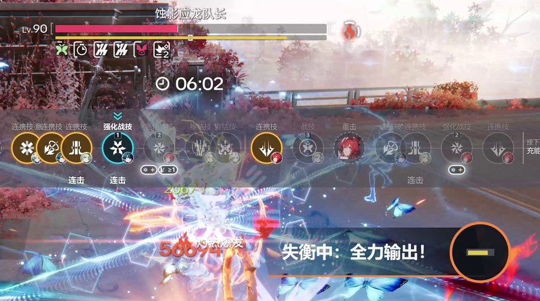

<details><summary>详细说明</summary>

- **失衡进度**：粉色部分填到整条的百分之几（0%–100%）。刚打上去的失衡值会先显示为更浅的一段，EndHud 直接算进去。处于失衡时算 100%。条件中选“失衡进度 · 至少 · 80%”。
- **失衡节点已达到**：失衡条上的小方框是失衡节点，粉色填过一个节点就是一次小失衡。条件中选“失衡节点已达到 · 至少 · 1”。节点个数从画面上读取，不同的敌人可能不一样（录像中的这个 Boss 在正中间有 1 个，也见过没有节点的 Boss）。填到节点时，游戏会把这个小方框放大约 1 秒，这期间 EndHud 按之前看到的节点继续计算，不会把小失衡重复提示一次。
- **处于失衡**：失衡条填满后变成黄色倒计时条，这时就是处于失衡（大失衡）。条件中选“处于失衡 · 处于失衡 / 未处于失衡”。
- **失衡剩余时间**：黄色倒计时条剩下的长度占整条的百分之几；没有处于失衡时算 0%。条件中选“失衡剩余时间 · 至多 · 30%”。**不提供秒数**：录像中倒计时一般每秒减少约 11%（这个 Boss 从满到空约 9 秒），但部分技能演出时倒计时会暂停最多约 3 秒，所以无法从长度换算成准确的秒数。
- **看不清时**：每个 Boss 都有失衡条。看得到 Boss 血条、但失衡条被特效或叠加显示挡住、读不出形状时，EndHud 沿用最后一次看清的数值（进度、节点、是否处于失衡、剩余时间都保持不变，倒计时不会自己往下减）；这个 Boss 出现后还没看清过时，按 0 算（未处于失衡、没有达到节点）。看不到 Boss 血条（不是 Boss 战、过场动画、血条被遮住）时算作“未知”：排轴不会因此切换轴段，战斗提示也会等到看清后再判断；Boss 血条消失约 5 秒后（战斗结束、换了 Boss），之前的数值清空，下一个 Boss 从 0 开始。
- **没有节点的 Boss**：有的 Boss 失衡条上没有节点，只有最后的大失衡。这时“失衡节点已达到 · 至少 · 1”一直不满足（不是未知），处于失衡和失衡剩余时间照常判断。

</details>

### 缘缘庄助手

在缘缘庄营业时给出建议，干员带头像、菜和饮品带图片，方便按图找。只给建议，不会替你操作游戏。

<details><summary>详细说明</summary>

**营业前**
- **营业设定**：每个厨房下方显示推荐的大厨和可替换的干员（还没上线的干员不会推荐），以及这个厨房要做的菜的类型。先满足全部菜单要求，再尽量符合主题热门，最后看收益。按推荐排好的厨房显示“已排好”。
- **安排干员**：显示正在安排的厨房的推荐。
- **设定菜单**：按已排好的厨师推荐菜品和饮品，已在菜单里的打勾，没有的换「可换」里的。菜单要求有一条没读懂时，面板会说明。

**营业中**：所有提示都在固定位置，打开或关上「派单」都不会移动。

- **厨房圆圈**：每个厨房下一道该排的菜，在屏幕中间下方、手上菜品的上面排成一行，左、中、右固定是厨房一、二、三，没有要排的厨房那格空着。圆圈里是菜的图，右边写着厨房、菜名和原因，排好了就收起：

  ```
  (菜的图) 厨房一 [点单]   (菜的图) 厨房二 [预做]       (菜的图) 厨房三 [换菜]
           白瓜肉丸汤               雪绵豆沙                    茄果鳞肉汤
           桌4 点的                 还没人点，先做好            先拿掉雪绵豆沙 · 桌5
  ```

  金色发光的圈是客人点的菜，青色虚线圈是预做（还没人点），橙红色的圈是先拿掉一道预做的菜、再排这道。打开「派单」时圆圈留在原处，当前厨房加金框；该排的菜的卡片上标出“排这个（桌3）”“预做这个”，其他有菜要排的厨房，标签上标“有菜要排”。提示出现后保持不变，直到排好、不再需要或被客人点的菜顶替。
- **老饕**：每位老饕一张卡片，位置按桌号固定：和游戏里桌子的位置一致：屏幕左边从上到下是桌1、3、5，右边从上到下是桌2、4、6，打开「派单」时也一直显示。每个要求一张图并编号（①②），是要分别上齐的几样，不是几选一；上了一样，剩下的编号不变。饮品要求推荐符合的最贵的饮品；菜单里没有符合的显示“没有合适的”。老饕要的菜也会作为点单出现在厨房圆圈里，上了这道菜就收起。一直显示到这桌老饕的要求都上齐。
- **建议换菜**：觉得换菜太快跟不上，可在菜单里关掉“建议换菜”（默认开）：关掉后不再提示拿掉排好的菜，点单排到有空位的厨房，没有空位就等。
- **满堂彩和收尾**：灶中火满了提示“开启满堂彩（R）”，快满时提示先把厨房排满；快打烊时，提示把出餐台上剩下的菜端给来不及做的桌（上错也有钱）。这两种提示用和连携技提示一样的横幅，默认在屏幕左侧，打开「派单」时先收起，菜单打开时可拖动。

切到别的窗口再回来，已记下的设定和营业状态都保留。需要 Windows 的“中文(简体，中国)”文字识别（没装时托盘会提示）。在菜单的“缘缘庄助手”一栏可开关助手、“派单提示”（厨房圆圈和横幅）和“建议换菜”，调整大小（厨房圆圈和老饕卡片只会变小）和不透明度（默认 85%，能看到后面的游戏画面）。菜单打开时显示示例圆圈和横幅。

</details>

### 调试面板

在菜单中勾选“显示调试面板”或按 Ctrl+Shift+D 打开，显示每位干员的生命值、连携技冷却、终结技充能和等级；无法读取时显示原因。每次启动时默认关闭。

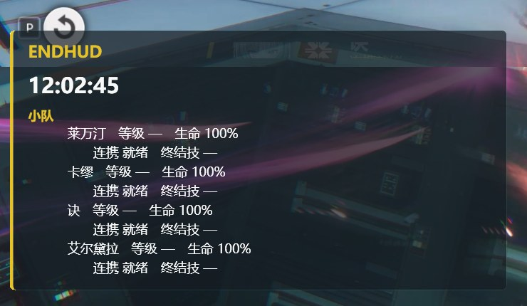

---

## 安装

1. 打开 **[Releases 页面](https://github.com/Nedlitex/EndHud/releases/latest)**，下载最新版本的 `EndHud-版本号.msi`。
2. 双击运行安装程序。安装完成后，开始菜单中会出现“EndHud”。
3. 安装新版本时会直接覆盖旧版本，设置保持不变。

> 首次运行时，Windows 可能提示“Windows 已保护你的电脑”（安装包暂未进行代码签名），点击“更多信息”→“仍要运行”即可。

**免安装版**：同一页面提供 `EndHud-版本号-portable.exe`，功能与安装版相同。

**卸载**：在“设置 → 应用 → 安装的应用”中找到 EndHud 并卸载。

### 系统要求

- Windows 10（2004 或更高版本）或 Windows 11。
- 游戏使用**无边框窗口**或**窗口**模式（独占全屏模式下，任何程序都无法显示在游戏上方）。

---

## 使用方法

1. 运行 EndHud，系统托盘中会出现金色“E”图标。
2. 切换到游戏时 EndHud 自动显示，切换到其他窗口时自动隐藏。
3. 进入战斗后，连携技冷却结束时显示提示。

### 快捷键

| 快捷键 | 作用 |
|---|---|
| **Ctrl+Shift+M** 或 **Ctrl+F9** | 打开/关闭菜单（设置、调整位置、指定干员） |
| **Ctrl+Shift+H** 或 **Ctrl+F10** | 显示/隐藏 HUD |
| **Ctrl+Shift+D** 或 **Ctrl+F11** | 显示/隐藏调试面板 |
| **Ctrl+Shift+Q** | 退出 EndHud |
| **Esc** | 关闭菜单 |

### 菜单设置

按 Ctrl+Shift+M 打开菜单，设置自动保存。各功能分栏显示，可通过右上角的“开启”单独关闭。菜单、排轴编辑器和战斗提示编辑器只在游戏或 EndHud 窗口位于最前方时置顶；切换到其他窗口（例如浏览器）时会退到它后面，方便一边查资料一边编辑。

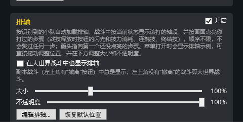

<details><summary>详细说明</summary>

- **通用**
  - **游戏窗口获得焦点时自动显示 HUD**：关闭后需按 Ctrl+Shift+H 手动显示。
  - **开机时自动启动 EndHud**（默认关闭）：登录 Windows 后在托盘中自动运行，不弹出提示。也可以在任务管理器的“启动应用”中关闭；卸载 EndHud 时会一并移除。
  - **识别小队栏**：读取小队栏和战斗界面。连携就绪提示、排轴、战斗提示和状态监视均依赖此项（缘缘庄助手不依赖）。
  - **显示调试面板**。
  - **游戏退出时自动关闭 EndHud**（默认关闭）：游戏窗口消失 10 秒后，EndHud 自行退出（切换全屏和窗口时窗口会短暂消失，不会因此关闭）。EndHud 比游戏先启动时，会等游戏出现后才开始判断。
  - **自动检查更新**：每天检查一次 EndHud 新版本、推荐排轴和干员头像库。
  - **自动安装 EndHud 新版本**（默认开启）：在游戏未运行时安装新版本并重新启动 EndHud。
  - **导出诊断信息**：见[常见问题](#常见问题)。
- **连携就绪提示**：显示方式、显示时长、恢复默认位置、在大世界战斗中也显示连携就绪提示（默认勾选）。
- **排轴**：大小（50%–200%）、不透明度（20%–100%）、打开排轴编辑器、恢复默认位置、在大世界战斗中也显示排轴（默认不勾选）。
- **状态监视**：大小（50%–200%）、恢复默认位置、在大世界战斗中也显示状态监视（默认勾选）。
- **战斗提示**：开启或关闭弹出、已有几条提示、编辑战斗提示、在大世界战斗中也弹出战斗提示（默认勾选）。位置跟随连携提示。
- 副本战斗（左上角有“撤离”按钮）中，以上四项总是显示；左上角没有“撤离”的战斗算大世界战斗。见[排轴的显示时机](#排轴)。
- **缘缘庄助手**：派单提示（厨房圆圈和横幅）、建议换菜、大小（50%–200%）、不透明度（默认 85%）、恢复默认位置（横幅）。
- **干员识别**：为识别错误的位置指定正确的干员；“清除所有已学习的头像”可撤销全部手动指定。

托盘图标右键菜单还提供：游戏检测状态、自动显示、**缘缘庄助手**开关、调试面板、**编辑排轴**、**编辑战斗提示**、**检查更新**、打开配置文件夹、**导出诊断信息**和退出。

</details>

### 更新

- **EndHud 新版本**：启动时及之后每天检查一次。默认在游戏未运行时自动下载、校验并安装新版本，然后重新启动，设置和数据保持不变。游戏运行期间发现的新版本会在游戏关闭后安装，也可以点击通知或托盘菜单中的“立即更新到 x.y.z”立即更新。关闭“自动安装 EndHud 新版本”后，发现新版本时仅显示通知。
- 更新失败时，当前版本继续正常运行，通知中会说明原因，点击可打开下载页面。
- 更新文件只从 EndHud 的 GitHub 发布页下载，下载后校验，确认是 EndHud 的安装包后才安装。以管理员身份运行 EndHud 时不会自动安装更新（通知中会说明），请正常打开 EndHud 后再更新。
- **干员头像库**：运行期间定期检查，发现新干员时显示通知。
- **手动检查**：右键托盘图标选择“检查更新”，同时检查 EndHud、推荐排轴和干员头像库。

---

## 支持的分辨率

适用于台式显示器和笔记本，支持 100%–200% 的 Windows 显示缩放；提示框始终按游戏窗口比例显示。

| 游戏窗口 | 干员名字、连携提示、生命值、终结技、阵亡 | 等级（仅调试面板） |
|---|---|---|
| 4K、5K、2560×1440 及同级别（含 21:9、16:10） | ✅ | ✅ 大部分可识别 |
| 1920×1080 及同级别、1600×900 | ✅ | 约一半可识别 |
| 1366×768、1280×720 | ✅ | 不识别 |

## 手柄

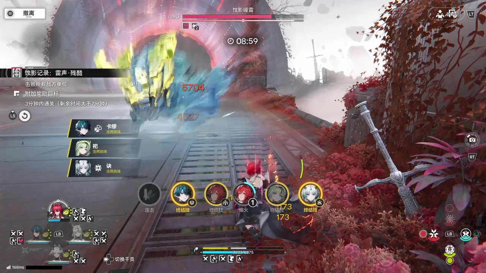

使用手柄时，游戏改用另一套界面：小队栏在左下角排成菱形，技能按钮在右下角排成菱形。EndHud 每次读取都会判断当前布局，战斗中也可以随时在键鼠和手柄之间切换。Xbox 手柄（LB）和 PlayStation 手柄（L1）都支持。

<details><summary>详细说明</summary>

| 手柄布局下 | |
|---|---|
| 干员名字、生命值、连携技冷却与就绪提示、技力、当前操作的干员、阵亡 | ✅ |
| 终结技充能：状态监视中的圆环随充能增长，就绪时高亮 | ✅ |
| 当前操控干员的专属计数（如熔火）、连击及其层数 | ✅ |
| 少于 4 人的小队 | ✅ |
| 战技释放时按钮的闪光（跟踪打到哪一步）、战技已强化（按钮外圈的白色光环） | ✅（闪光在按住 LB 时的按钮上读取；光环按不按住 LB 都能读） |
| 按住 LB（L1）时 | 小队栏照常读取；终结技显示为带图标的大圆环，此时保持松开 LB 前的读数 |
| 战技冷却、等级、祀的战技持续时间、其他干员头像上的专属计数 | 暂不识别（其他干员的计数显示最后一次读取的数值，变暗显示） |

排轴中的“战技 就绪 / 冷却中”和“战技持续中”条件，在手柄布局下暂时无法判断；“战技已强化”可以判断。无需任何设置：拿起手柄操作后，游戏切换界面，EndHud 随之切换；改回键鼠同样如此。

</details>

---

## 常见问题

**游戏中看不到 EndHud**
请确认游戏使用无边框窗口或窗口模式，且 EndHud 正在托盘中运行。也可按 Ctrl+Shift+H 手动显示。

**干员显示为“1 号位”或识别错误**
小队栏出现后约一秒内完成识别。如有错误，按 Ctrl+Shift+M 打开菜单，在“干员识别”中为该位置指定正确的干员。

**提示略有延迟**
EndHud 约每 0.25 秒读取一次画面，提示可能比冷却结束稍晚出现。画面被特效遮挡时沿用上一次的读取结果，并在下次读取时更正。

**一直显示“正在识别小队栏”或出现其他问题**
调试面板会显示无法识别的原因。如需反馈，请右键托盘图标（或在菜单“通用”一栏中）选择“导出精简诊断”或“导出完整诊断”，桌面上会生成诊断压缩包（UID 已遮挡，日志中不含 Windows 用户名）。精简版 `EndHud-diagnostics-mini-日期时间.zip` 小于 20 KB，包含最近的运行日志、设置和游戏画面左下、右下角的小截图，方便在只能传小文件的地方上传；完整版 `EndHud-diagnostics-full-日期时间.zip` 有几 MB，包含全部日志和完整的游戏截图，能看出更多问题。请在 [GitHub Issues](https://github.com/Nedlitex/EndHud/issues) 或反馈帖中附上该文件。

**截图或录屏中没有 EndHud 的提示**
少数情况下，EndHud 无法获取游戏窗口的画面。此时如果系统支持，EndHud 改为读取屏幕上游戏所在的区域，并将自身 HUD 排除在截图和录屏之外，以免读取到自己的提示。在这种模式下，游戏需位于最前方并完整显示在屏幕内；被遮挡或超出屏幕时，调试面板会显示原因。

**开启 MSI Afterburner（RivaTuner）的屏幕显示后识别不正常**
MSI Afterburner 的屏幕显示（帧数、温度等，由 RivaTuner Statistics Server，即 RTSS 绘制）是直接画进游戏画面的，EndHud 读取游戏画面时也会读到它，挡住的部分就无法识别。请把它移出画面上下（或左右）的黑边（16:10、带鱼屏等非 16:9 显示器会有黑边），并避开游戏界面所在的位置：左下的小队栏、右下的技能按钮、缘缘庄左上的标题与计时和顶部的餐桌卡片；默认的左上角会挡住缘缘庄的计时。也可以在玩终末地时关闭屏幕显示。另外可在 RTSS 中为 EndHud.exe 单独添加一项并让 RTSS 不对它生效（可选，只影响 EndHud 自己的窗口）。导出的诊断信息会注明 RTSS 是否在运行。

**设置保存位置**
`%APPDATA%\EndHud`。右键托盘图标选择“打开配置文件所在文件夹”即可打开；删除其中的 `config.json` 可恢复默认设置。

---

## 开发者

构建、测试、发布流程和技术细节见 [DEVELOPER.md](DEVELOPER.md)（英文）。

## 关于游戏素材

EndHud 附带的干员头像、技能图标和状态图标（`operators/operator-library.zip`）取自社区 [Endfield Talos Wiki](https://endfield.wiki.gg)（CC BY-SA 4.0），图像版权归游戏开发商和发行商所有，仅用于在本机识别干员。本页截图来自游戏画面，仅作说明之用。干员识别使用 DeepGHS 的 CCIP 角色识别模型（OpenRAIL 许可），第三方组件说明见 [THIRD-PARTY-NOTICES.md](THIRD-PARTY-NOTICES.md)。
