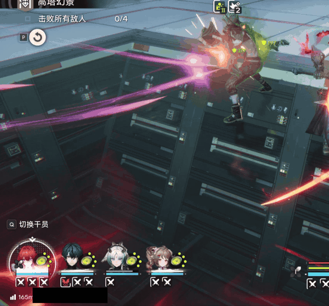
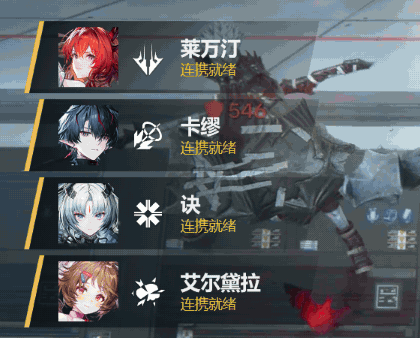

# EndHud

**《明日方舟：终末地》的游戏辅助面板。** 支持监控干员连携冷却，并于冷却结束时提示。

EndHud 是一个独立运行的小程序，只通过**读取屏幕**来获取信息，和录屏软件截取游戏画面的方式一样。它**不会**打开、读取或修改游戏进程，不注入任何代码，也不会替你操作游戏。

> ⚠️ **免责声明**
>
> 在网络游戏中使用任何第三方工具均存在风险。游戏使用 ACE 反作弊系统，运营方的用户协议也可能对第三方软件有所限制。EndHud 的设计完全在游戏进程之外运行，但这并不能保证反作弊系统不会将其识别为违规程序。
>
> 是否使用本工具，请您在充分了解上述风险后自行决定，并对自己的游戏账号负责。因使用本工具产生的一切后果（包括但不限于账号警告、封禁）均由使用者自行承担，开发者不承担任何责任。

---

## 功能

### 连携就绪提示

战斗中，某位干员的连携技冷却结束时滑入提示。

- **两种显示方式**（在菜单里选择）：
  - **冷却结束时提示**：冷却结束时显示几秒（2、3 或 5 秒，默认 3 秒），然后自动滑出。
  - **冷却结束后一直显示，直到再次使用**：只要连携技处于就绪状态就一直显示。
- **位置可以拖动**：打开菜单（Ctrl+Shift+M）后，直接用鼠标拖动屏幕上的提示框；“恢复默认位置”可以放回原处。位置按游戏窗口的比例保存，改变窗口大小后仍在相同位置。
- 被技能提前刷新的冷却（冷却条直接跳满）同样会提示；在终结技动画期间结束的冷却，会在画面恢复后提示。
- 非战斗状态、已阵亡的干员，以及战斗一开始就已就绪的连携技不会提示。

### 自动识别干员

EndHud 会根据小队栏的头像自动识别四位干员，提示中显示对应的名字和头像。首次运行时，EndHud 会自动从 Endfield Wiki 下载全部干员的头像和技能图标（约 1 MB，保存在本机），之后每周自动检查一次，游戏推出新干员后也能识别。

第一次识别可能不准。在菜单的“干员识别”中为每个位置选择正确的干员，EndHud 会记住该干员在游戏中的样子，之后就能准确识别。识别不出的位置显示为“n 号位”。

### 调试面板

打开调试面板（菜单里勾选“显示调试面板”，或按 Ctrl+Shift+D）：每位干员的生命值、连携技冷却、终结技充能，以及等级。默认关闭。

---

## 安装

1. 打开本项目的 **Releases** 页面，下载最新版本的 `EndHud-版本号.msi`。
2. 双击运行安装程序。只为当前用户安装，**不需要管理员权限**，安装完成后开始菜单里会出现“EndHud”。
3. 首次运行时需要联网，用于下载干员头像（约 1 MB）。
4. 以后安装新版本会直接覆盖旧版本，设置和已学习的头像都会保留。

> 首次运行时，Windows 可能提示“Windows 已保护你的电脑”（安装包暂未进行代码签名）。点击“更多信息”→“仍要运行”即可。

**不想安装？** 同一页面还提供 `EndHud-版本号-portable.exe`，下载后直接双击运行即可，效果相同。

**卸载**：在“设置 → 应用 → 安装的应用”中找到 EndHud，点击卸载。

### 系统要求

- Windows 10（2004 或更新版本）或 Windows 11。
- 游戏需使用**无边框窗口**或**窗口**模式。独占全屏模式下任何程序都无法显示在游戏上方。
- 无需另外安装 .NET 或其他组件。

---

## 使用方法

1. 运行 EndHud，它会出现在屏幕右下角的**系统托盘**中（一个金色的“E”图标）。
2. 切换到游戏，EndHud 会自动显示；切换到其他窗口时自动隐藏。
3. 进入战斗后，连携技冷却结束时就会弹出提示。

### 快捷键

| 快捷键 | 作用 |
|---|---|
| **Ctrl+Shift+M** | 打开/关闭菜单（设置、调整提示位置、选择干员） |
| **Ctrl+Shift+H** | 显示/隐藏 HUD |
| **Ctrl+Shift+D** | 显示/隐藏调试面板 |
| **Ctrl+Shift+Q** | 退出 EndHud |
| **Esc** | 关闭菜单 |

### 菜单设置

按 Ctrl+Shift+M 打开菜单，所有设置都会自动保存：

- **游戏窗口获得焦点时自动显示 HUD**：关闭后，需要按 Ctrl+Shift+H 手动显示。
- **识别小队栏**：连携就绪提示需要此项。
- **显示调试面板**。
- **连携就绪提示**：开关、显示方式、显示时长、恢复默认位置。
- **干员识别**：为每个位置选择正确的干员；“清除所有已学习的头像”可以重新开始。

右键托盘图标还可以：查看是否检测到游戏、切换自动显示和调试面板、**更新干员头像库**（游戏推出新干员后，从 Wiki 下载最新的头像和技能图标）、打开配置文件夹、退出。

---

## 支持的分辨率

在台式显示器和笔记本上都可以使用，与 Windows 的显示缩放比例（100%–200%）无关，提示框始终占游戏窗口相同的比例。

| 游戏窗口 | 连携提示、生命值、终结技、阵亡 | 等级（仅调试面板） |
|---|---|---|
| 4K、5K、2560×1440 及同级别（含 21:9、16:10 带鱼屏） | ✅ | ✅ 大部分可识别 |
| 1920×1080 及同级别、1600×900 | ✅ | 约一半可识别 |
| 1366×768、1280×720 | ✅ | 不识别 |

---

## 常见问题

**游戏里看不到 EndHud？**
确认游戏使用无边框窗口或窗口模式，并且 EndHud 正在托盘中运行。也可以按 Ctrl+Shift+H 手动显示。

**名字显示成“1 号位”或认错了人？**
首次运行时，下载干员头像需要几秒钟；如果没有联网，EndHud 会自动重试（菜单的“干员识别”中会显示原因）。下载完成后仍然认错的话，按 Ctrl+Shift+M 打开菜单，在“干员识别”中为该位置选择正确的干员，EndHud 会记住。

**提示偶尔晚一点出现？**
EndHud 每秒读取一次画面，所以提示最多会比冷却结束晚一秒左右。被特效遮挡时，会沿用上一次读到的结果，下次读取时自动更正。

**设置保存在哪里？**
`%APPDATA%\EndHud`。右键托盘图标选择“打开配置文件所在文件夹”即可找到；删除其中的 `config.json` 可以恢复默认设置。

---

## 开发者

构建、测试、发布流程和技术细节见 [DEVELOPER.md](DEVELOPER.md)（英文）。

## 关于游戏素材

EndHud 本身不包含任何游戏素材：干员头像和技能图标在运行时从社区 Wiki 下载到本机。本页截图来自游戏画面，仅作说明之用。
